

  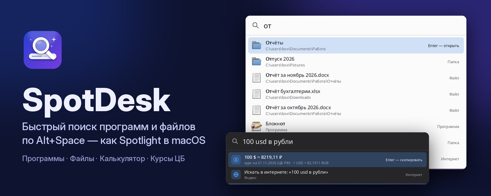

  
   Скачивается сразу ZIP с последней версией · <a href="https://github.com/NikoliniOFF/SpotDesk/releases">Все версии</a>

  
  
  

<h1 align="center">SpotDesk для Windows</h1>

  <b>Нажмите <kbd>Alt</kbd>+<kbd>Space</kbd> и начните печатать — программа, файл или ответ найдутся за долю секунды.</b> 
  Посередине экрана появляется строка поиска: Enter открывает, Esc прячет. Ещё она считает, как калькулятор, переводит валюты и единицы, подсказывает время в других городах, открывает нужную страницу «Параметров Windows» и выключает компьютер. Как Spotlight в macOS, только для Windows 10 и 11. 
  Бесплатно · без установки · без рекламы и без слежки · обновляется сама.

---

## ✨ Что умеет

| | |
|---|---|
| 🔎 **Программы** | Ярлыки меню «Пуск» и рабочего стола, приложения Microsoft Store (Калькулятор, Параметры, Фотографии…) и программы Nikolini. Нечёткий поиск: «vsc» найдёт Visual Studio Code, «тлг» — Telegram. То, что вы открываете чаще, поднимается выше. |
| 📁 **Файлы и папки** | Свой индекс имён, как в Everything: Рабочий стол, Документы, Загрузки, Изображения, Музыка, Видео и любые ваши папки. Строится в фоне с низким приоритетом и обновляется сам, когда файлы меняются. Можно включить быстрый индекс всего диска NTFS (нужны права администратора). |
| 🧮 **Калькулятор** | `2+2*2`, `(15+5)/4`, `sqrt 16`, `2^10`, `15% от 3000`, `sin 30` — ответ сразу первой строкой, Enter копирует его в буфер. Запятая и точка — как удобно. |
| 💱 **Курсы валют** | `100 usd в rub`, `100$`, `50 евро в рублях`, `курс юаня` — по официальному курсу ЦБ РФ на сегодня (если сайт ЦБ недоступен — open.er-api.com). В строке видно, на какую дату курс и когда он проверен. Курс проверяется, когда вы открываете панель или пересчитываете валюту и ему больше часа, в простое в сеть SpotDesk не ходит. |
| 📏 **Единицы измерения** | `5 км в милях`, `30c to f`, `10 фунтов в кг`, `1 гб в мб`, `100 км/ч`, `10 соток в м2`, `2 часа в минутах` — длина, вес, температура, площадь, объём, скорость, размеры файлов и время. Без интернета. |
| 🕒 **Даты и время** | `время в токио`, `который час в нью-йорке`, `дней до нового года`, `дней до 31.12`, `через 100 дней`, `сегодня`. Больше 70 городов, по часовым поясам Windows. |
| ⏻ **Команды** | `блокировка`, `сон`, `перезагрузка`, `выключить`, `выйти`, `выключить экран`, `очистить корзину`. Перезагрузка, выключение, выход и очистка корзины — только после второго <kbd>Enter</kbd>. |
| ⚙️ **Параметры Windows** | `bluetooth`, `экран`, `wi-fi`, `звук`, `обновления`, `автозагрузка`, `мышь`, `обои`… — сразу открывается нужная страница. |
| ⌨️ **Всё с клавиатуры** | <kbd>↑</kbd> <kbd>↓</kbd> — выбор, <kbd>Enter</kbd> — открыть, <kbd>Ctrl</kbd>+<kbd>Enter</kbd> — показать в папке, <kbd>Shift</kbd>+<kbd>Enter</kbd> — от имени администратора, <kbd>Tab</kbd> — дополнить, <kbd>Esc</kbd> — спрятать. Мышью тоже можно. |
| 💬 **Ответы из интернета прямо в окне** | <kbd>Enter</kbd> на строке «Искать в интернете» — и без браузера появляются быстрый ответ (обычно из Википедии) и до 10 ссылок с названием, сайтом и кусочком текста. <kbd>Enter</kbd> или щелчок открывает ссылку, <kbd>Ctrl</kbd>+<kbd>C</kbd> копирует её, «Открыть всю выдачу в браузере» — ваш поисковик. Ссылки берутся из DuckDuckGo, быстрый ответ — из DuckDuckGo и Википедии (ключи не нужны). **Пока вы печатаете, в интернет ничего не уходит**: запрос отправляется только по <kbd>Enter</kbd>. |
| 🌐 **Поиск в интернете** | Не нашлось на компьютере — последняя строка ищет в Яндексе, Google, DuckDuckGo или Bing (выбирается в настройках). <kbd>Ctrl</kbd>+<kbd>Enter</kbd> — сразу в браузере. Быстрые префиксы: `g …` — Google, `я …` — Яндекс, `yt …` — YouTube, `вики …` — Википедия, `? …` — ваш поисковик. |
| ⚡ **Лёгкая** | Панель появляется мгновенно, буквы — сразу, даже когда в индексе сотни тысяч файлов (файлы ищутся в фоне). В простое SpotDesk не тратит процессор: никаких опросов и хуков клавиатуры — только системная горячая клавиша и уведомления файловой системы. Графика загружается при показе и выгружается после. |
| 🎛️ **Всё отключается** | У каждой функции свой переключатель: программы, Store, файлы, калькулятор, валюты, единицы, даты, команды, параметры Windows, интернет и префиксы, ответы из интернета в окне, нечёткий поиск, история, плавное появление, акрил, автозапуск. Горячая клавиша меняется. |
| 🌗 **Светлая и тёмная тема** | Следует теме Windows или выбирается вручную. Панель появляется и гаснет плавно. По желанию — полупрозрачный фон: акрил в Windows 11, размытие в Windows 10. |

## 📸 Как это выглядит

 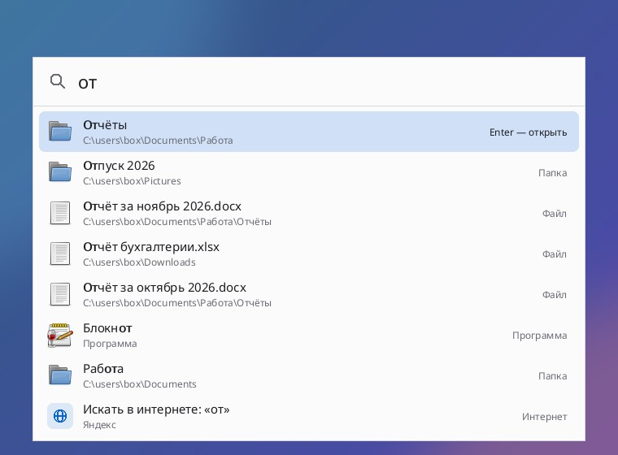

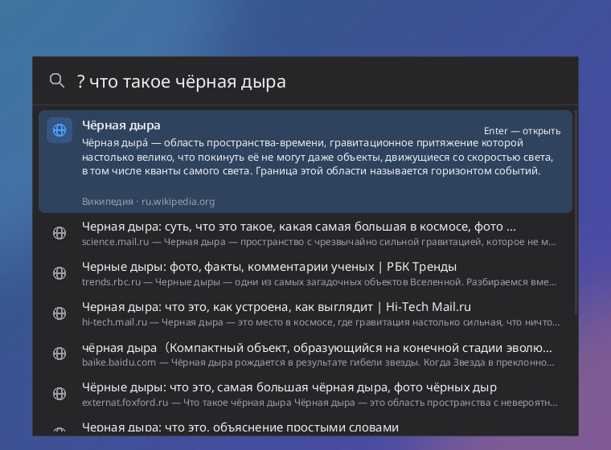 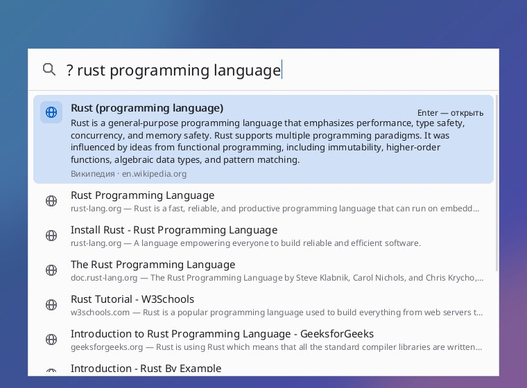

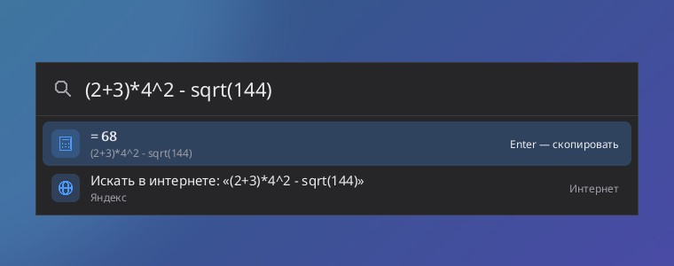 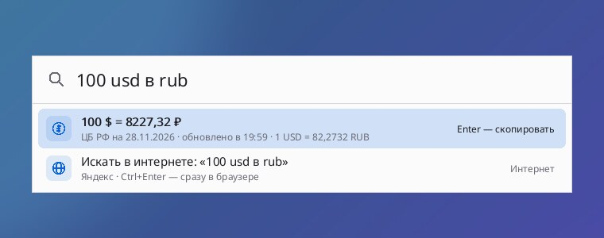

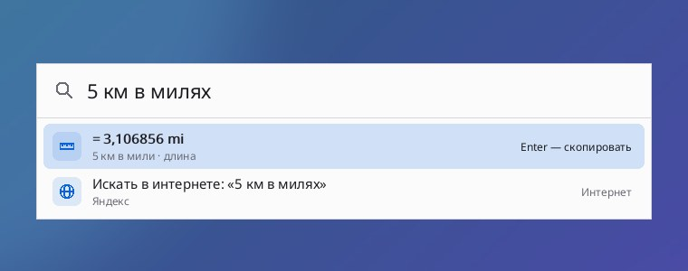 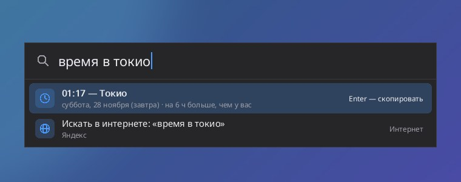

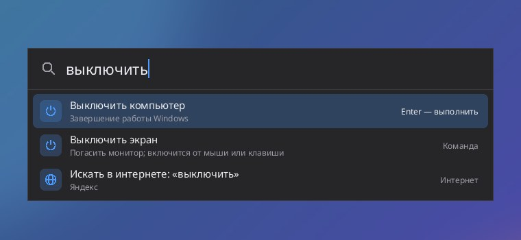 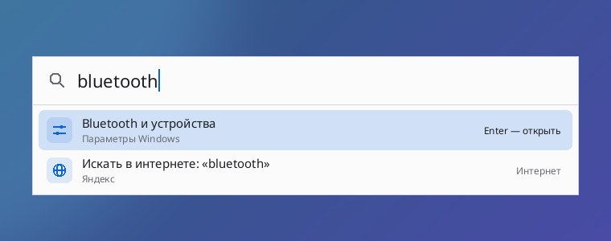

  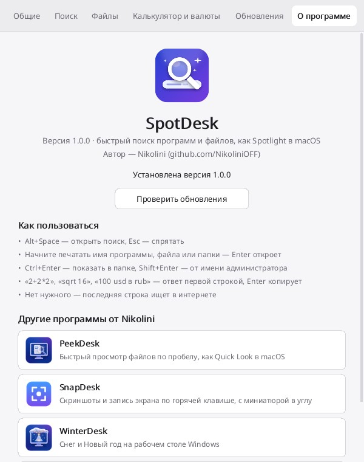

## 📥 Как установить

1. Скачайте **[SpotDesk-win64.zip](https://github.com/NikoliniOFF/SpotDesk/releases/latest/download/SpotDesk-win64.zip)** (или выберите файл на странице [последней версии](https://github.com/NikoliniOFF/SpotDesk/releases/latest)).
2. Распакуйте архив в постоянную папку, например `Документы\SpotDesk`.
3. Запустите **SpotDesk.exe** — значок появится в трее у часов. Нажмите <kbd>Alt</kbd>+<kbd>Space</kbd>.
4. Если Windows покажет синее окно *«Система Windows защитила ваш компьютер»*, нажмите **«Подробнее» → «Выполнить в любом случае»** (подробнее — в разделе «Вопросы»).

> Устанавливать ничего не нужно: SpotDesk — одна программа. При первом запуске он добавляет себя в автозапуск, чтобы поиск работал сразу после входа в Windows (выключается в настройках). Чтобы удалить, выберите «Выход» в меню значка и удалите папку.

## ⌨️ Клавиши

| Клавиша | Действие |
|---|---|
| <kbd>Alt</kbd>+<kbd>Space</kbd> | открыть или спрятать поиск (меняется в настройках, например на <kbd>Ctrl</kbd>+<kbd>Space</kbd>) |
| <kbd>↑</kbd> <kbd>↓</kbd> · <kbd>PgUp</kbd> <kbd>PgDn</kbd> | выбрать строку |
| <kbd>Enter</kbd> | открыть программу, файл или папку; для расчёта, курса, единиц и дат — скопировать ответ; для перезагрузки и выключения — нажать дважды |
| <kbd>Ctrl</kbd>+<kbd>Enter</kbd> | показать файл в папке; на «Искать в интернете» — открыть поиск сразу в браузере |
| <kbd>Shift</kbd>+<kbd>Enter</kbd> | запустить от имени администратора |
| <kbd>Tab</kbd> | дополнить запрос названием выбранной строки |
| <kbd>Ctrl</kbd>+<kbd>C</kbd> | без выделенного текста — скопировать путь, ответ или ссылку |
| <kbd>Esc</kbd> | спрятать поиск (или щёлкните мимо) |

## ⚙️ Настройки

Щёлкните значок SpotDesk в трее (справа внизу, у часов) → **«Настройки»**. Вкладки: **Общие** (горячая клавиша, тема, плавное появление, полупрозрачный фон, автозапуск), **Поиск** (что искать, команды, параметры Windows, поисковик и префиксы, нечёткий поиск, история), **Файлы** (папки, исключения, скрытые файлы, быстрый индекс NTFS), **Расчёты** (калькулятор, валюты, единицы, даты и время), **Обновления** и **О программе**.

Настройки хранятся в `%APPDATA%\SpotDesk\settings.ini`, индекс файлов — в `%LOCALAPPDATA%\SpotDesk`.

## 🔄 Как обновлять

SpotDesk сам проверяет новые версии на этой странице: через минуту после запуска и затем раз в 12 часов. В настройках, вкладка **«Обновления»**, можно выбрать **«Автоматически»**, **«Спрашивать»** *(по умолчанию)* или **«Не проверять»** (тогда — пункт «Проверить обновления» в меню значка). Каждый выпуск проверяется по размеру и контрольной сумме SHA-256, настройки сохраняются.

## 🧰 Требования

- Windows 10 или Windows 11, 64-бит.

## ❓ Вопросы

<b>Windows пишет «Система Windows защитила ваш компьютер»</b>

Это фильтр SmartScreen: программа новая и пока не подписана платным сертификатом. Нажмите **«Подробнее»**, затем **«Выполнить в любом случае»**. Скачивайте SpotDesk только со [страницы выпусков](https://github.com/NikoliniOFF/SpotDesk/releases) — рядом с каждым архивом лежит файл `.sha256` с контрольной суммой.

<b>Alt+Space не срабатывает</b>

Это сочетание может быть занято другой программой — например, PowerToys Run (PowerToys Command Palette) — или системным меню окна в некоторых программах. SpotDesk предупредит, если не смог занять клавишу. Откройте настройки, щёлкните по сочетанию и нажмите другое, например <kbd>Ctrl</kbd>+<kbd>Space</kbd> или <kbd>Win</kbd>+<kbd>Space</kbd>.

<b>Полупрозрачный фон не включается</b>

Включите его в **«Настройки → Общие → Полупрозрачный фон»** и проверьте, что в Windows включены **«Эффекты прозрачности»** (Параметры → Персонализация → Цвета). В режиме экономии заряда Windows сама делает фон сплошным. В Windows 11 22H2 и новее это системный акрил, в Windows 10 и Windows 11 21H2 — размытие.

<b>Не будет ли тормозить компьютер?</b>

Нет. В трее SpotDesk ничего не опрашивает — просыпается по горячей клавише и когда Windows сообщает об изменении файлов. Индекс строится в фоне с низким приоритетом (диск и процессор уступают другим программам) и хранится компактно: несколько десятков байт на файл.

<b>Почему не находятся файлы с диска D:?</b>

По умолчанию SpotDesk индексирует папки пользователя. Добавьте нужные папки во вкладке **«Файлы»** или включите **«Быстрый индекс NTFS»** — он читает весь диск за секунды, но работает только когда SpotDesk запущен от имени администратора (кнопка там же).

<b>Откуда ответы из интернета и почему не из Яндекса или Google?</b>

Ссылки в окне берутся из DuckDuckGo (его простая HTML-страница), быстрый ответ — из мгновенных ответов DuckDuckGo и из Википедии. Ключи и учётные записи не нужны. Яндекс и Google не разрешают показывать свою выдачу в сторонних программах и закрывают её капчей, поэтому в окне — DuckDuckGo, а строка «Открыть всю выдачу в браузере» открывает поисковик, выбранный в настройках. Если DuckDuckGo попросит подтвердить, что вы не робот, нет интернета или ответа нет 6 секунд, SpotDesk так и напишет и покажет статьи Википедии. Выключить: «Настройки → Поиск → Ответы из интернета прямо в окне».

<b>Программа что-нибудь собирает или отправляет?</b>

Нет. Без рекламы и без слежки: индекс и история запусков остаются только на вашем компьютере. В интернет SpotDesk обращается лишь к GitHub — проверить обновления и список других программ Nikolini (когда открыта вкладка «О программе»), — к сайту ЦБ РФ за курсами валют (когда вы открываете панель или пересчитываете валюту, а курсу больше часа) и — только после того как вы нажали <kbd>Enter</kbd> на «Искать в интернете» — к DuckDuckGo и Википедии за ответом на этот запрос. Пока вы печатаете, ничего не отправляется. Запросы и ссылки нигде не сохраняются. Обновления, курсы и ответы из интернета выключаются в настройках.

## 🧩 Другие программы от Nikolini

<table>
  <tr>
    <td width="96" align="center"></td>
    <td>
      <b><a href="https://nikolinioff.github.io/HubDesk/">HubDesk</a></b> — лаунчер Nikolini: все программы в одном окне — установка галочками, автозапуск и обновления. 
      <a href="https://nikolinioff.github.io/HubDesk/">Сайт</a> · <a href="https://github.com/NikoliniOFF/HubDesk">GitHub</a>
    </td>
  </tr>
  <tr>
    <td width="96" align="center"></td>
    <td>
      <b><a href="https://nikolinioff.github.io/WinterDesk/">WinterDesk</a></b> — снег на рабочем столе Windows: сугробы на окнах, гирлянды, ёлочка и отсчёт до Нового года. 
      <a href="https://nikolinioff.github.io/WinterDesk/">Сайт</a> · <a href="https://github.com/NikoliniOFF/WinterDesk">GitHub</a>
    </td>
  </tr>
  <tr>
    <td width="96" align="center"></td>
    <td>
      <b><a href="https://nikolinioff.github.io/PeekDesk/">PeekDesk</a></b> — предпросмотр файлов по пробелу в Проводнике Windows, как Quick Look в macOS. 
      <a href="https://nikolinioff.github.io/PeekDesk/">Сайт</a> · <a href="https://github.com/NikoliniOFF/PeekDesk">GitHub</a>
    </td>
  </tr>
  <tr>
    <td width="96" align="center"></td>
    <td>
      <b><a href="https://nikolinioff.github.io/SnapDesk/">SnapDesk</a></b> — скриншоты и запись экрана по горячей клавише, как в macOS: миниатюра в углу, которую можно перетащить в Discord. 
      <a href="https://nikolinioff.github.io/SnapDesk/">Сайт</a> · <a href="https://github.com/NikoliniOFF/SnapDesk">GitHub</a>
    </td>
  </tr>
  <tr>
    <td width="96" align="center"></td>
    <td>
      <b><a href="https://nikolinioff.github.io/DockDesk/">DockDesk</a></b> — док для Windows, как в macOS: любимые программы внизу экрана, значки плавно растут под курсором. 
      <a href="https://nikolinioff.github.io/DockDesk/">Сайт</a> · <a href="https://github.com/NikoliniOFF/DockDesk">GitHub</a>
    </td>
  </tr>
  <tr>
    <td width="96" align="center"></td>
    <td>
      <b><a href="https://nikolinioff.github.io/IslandDesk/">IslandDesk</a></b> — «динамический остров» для Windows: музыка, громкость, таймер, загрузки и уведомления в живой пилюле вверху экрана. 
      <a href="https://nikolinioff.github.io/IslandDesk/">Сайт</a> · <a href="https://github.com/NikoliniOFF/IslandDesk">GitHub</a>
    </td>
  </tr>
  <!-- Список обновляет tools/update_cards.py из apps.json HubDesk (HubDesk первым). -->
</table>

Все программы — на [github.com/NikoliniOFF](https://github.com/NikoliniOFF).

## 💬 Обсуждение

- 💡 [Предложить идею](https://github.com/NikoliniOFF/SpotDesk/discussions/new/choose)
- 🐞 [Сообщить о баге](https://github.com/NikoliniOFF/SpotDesk/issues/new?template=bug.yml)
- 💬 [Все обсуждения](https://github.com/NikoliniOFF/SpotDesk/discussions)

---

SpotDesk · автор — <a href="https://github.com/NikoliniOFF">Nikolini (NikoliniOFF)</a> · бесплатно, без рекламы и без слежки

